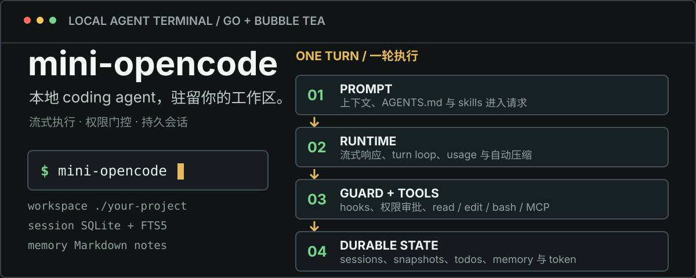

# mini-opencode

<p align="center">
  
</p>

<p align="center">
  Go 实现的本地 coding agent 终端：Bubble Tea TUI、流式 agent runtime、受控工具执行、持久会话与可扩展 provider。
</p>

<p align="center">
  macOS · Windows 10/11 · Go 1.25 · MIT
</p>

`mini-opencode` 同时提供交互式 TUI 和行模式 CLI。终端输入时进入 TUI；stdin 来自管道时使用同一套 runtime 执行行模式任务。项目独立实现，不依赖仓库中的历史 agent 实现。

## 快速开始

### npm / pnpm

需要 Node.js 18 或更高版本。Node 只负责启动，实际运行的是当前平台的 Go 原生二进制。

```bash
npm install --global @wislist/mini-opencode
# 或
pnpm add --global @wislist/mini-opencode

mini-opencode
```

安装时请保留 optional dependencies。当前原生包覆盖 macOS 与 Windows 10/11 的 arm64、x64。

### 从源码运行

macOS：

```bash
make run
```

Windows PowerShell：

```powershell
go run ./cmd/mini-opencode
# 或构建带 Git 版本号的可执行文件
./scripts/build.ps1
```

没有配置 Provider 时，TUI 会显示首次配置引导，普通消息不会发送给内部 `echo` fallback。按 Enter 先选择 DeepSeek、OpenAI、OpenRouter、自定义 OpenAI-compatible 或本地 Echo；已知供应商只需填写 API Key，自定义供应商再填写名称、地址和密钥。程序验证连接并拉取 `/models`，确认模型后才一次性写入全局配置。`/provider add` 仍保留三框高级入口。

## 工作方式

| 阶段 | 运行内容 |
| --- | --- |
| 1. 上下文 | 组装 coder prompt、工具 schema、`AGENTS.md`、skills 与按需召回的 memory。 |
| 2. Runtime | 流式获取回复；遇到 tool call 就执行并继续 turn loop，直到任务结束或命中上限。 |
| 3. 守卫与工具 | Hook 先判定，permission policy 再审批；只读调用可批量并发，写操作串行。 |
| 4. 本地状态 | SQLite 保存消息、文件快照、todo、token 与 FTS5 索引；Markdown 保存跨会话记忆。 |

## 核心能力

### Agent loop

- SSE 流式响应、usage 累计、provider 级 retry/backoff 与 run 级重试。
- `SafetyHook`、`LoopGuardHook`、`PlanModeHook` 同时覆盖 CLI 与 TUI。
- TUI 用 `tab` 切换 plan 模式；计划批准后继续复用当前对话状态。
- todo 是执行链的一部分：未完成时 runtime 自动续跑；阻塞时由 agent 显式说明原因。

### 工作区保护

- 默认只允许内置文件工具访问启动目录及 `workspace.allowed_roots`。
- 已存在文件默认必须先 `read` 才能 `write` / `edit`。
- 修改前保存会话级快照，`/undo` 恢复最近一次文件变更。
- `write` / `edit` 审批展示 diff；权限模式切换不会清空对话。

### 上下文与记忆

- 上下文窗口来源依次为显式配置、内置模型表、标明“估值”的保守 8192 占位值。
- 自动压缩按剩余空间触发：大于 200k 的窗口保留 20k，其余默认保留 20%；显式 `agent.compact_threshold` 继续使用旧的已用比例语义。
- 压缩非破坏性：原消息保留在内存与 SQLite，仅发送给 provider 的视图从摘要标记处截断。
- `.mini-opencode/memory/*.md` 是可读写的长期记忆；支持主动记录、后台提炼、词面召回和可选 embedding + RRF。

### Provider 与扩展

- 内置 `echo` 作为启动 fallback，也可由用户显式选择；支持多个 OpenAI-compatible provider、自定义名称、端点、模型目录与上下文窗口。
- 会话中切换 provider 或 model 会保留对话；切换只影响当前进程，新增、刷新和窗口设置写入全局配置。
- MCP 支持 `stdio`、streamable HTTP 与 legacy SSE，工具名以 `<server>__<tool>` 注册。
- 内置文件、shell、todo、只读子 agent、Web、skill 安装与 memory 工具。

## 常用交互

### 命令

| 命令 | 用途 |
| --- | --- |
| `/status` | 查看 workspace、分支、权限、provider、session、上下文与 token。 |
| `/permissions` | 在 TUI 打开权限菜单；带参数时直接切换模式。 |
| `/provider` / `/model` | 打开目录菜单或带参数切换；对话状态保持不变。 |
| `/mcp` | 查看每个 MCP server 的连接状态与工具数。 |
| `/session` / `/newsession` / `/fork` | 切换、新建或分支会话。 |
| `/undo` / `/compact` / `/memory` | 恢复文件、手动压缩上下文、查询长期记忆。 |
| `/init` | 分析当前项目并创建或刷新 `AGENTS.md`。 |

输入 `/` 会打开补全菜单。完整命令与参数见 [docs/commands.md](docs/commands.md)。

### TUI 按键

| 按键 | 行为 |
| --- | --- |
| `enter` | 发送消息。 |
| `shift+enter` / `ctrl+j` / `alt+enter` | 在多行输入框中换行。 |
| `tab` | 切换 plan 模式，或接受当前补全项。 |
| `ctrl+t` | 折叠或展开 todo 摘要；新一轮用户消息开始时清空上一轮 todo。 |
| `esc` | 中断运行、拒绝审批或关闭当前浮层。 |
| `ctrl+c` | 空闲时退出，运行中中断。 |
| 鼠标拖拽 | 按屏幕实际渲染结果选择并复制文本。 |

## 配置

配置分两层：

```text
~/.mini-opencode/config.json             全局 provider、模型、窗口与 API key
<project>/.mini-opencode/config.json     workspace、memory、MCP 等项目设置
```

项目配置中的 `provider`、`providers`、`active_provider` 会被忽略，避免项目仓库覆盖全局密钥和模型目录。

### Provider

推荐用环境变量保存密钥：

```json
{
  "providers": [
    {
      "name": "relay",
      "base_url": "https://relay.example.com/v1",
      "api_key_env": "RELAY_API_KEY",
      "models": ["your-model"],
      "model": "your-model"
    }
  ],
  "active_provider": "relay"
}
```

密钥解析优先级为 `api_key` → `api_key_env`。未知模型的窗口会显示为估值；优先使用 `/model refresh` 接收厂商上报值，或用 `/model context 128K` 显式设置。

### 权限模式

| 模式 | 行为 |
| --- | --- |
| `ask` | 默认；危险或需确认的调用交给用户审批。 |
| `auto-review` | 只自动批准保守的本地文件写入和精确只读目录命令；不是模型审核器。 |
| `full-access` | 需显式确认；跳过逐次审批与工作区路径限制，但仍受 hooks、plan 模式、先读后写和当前系统账户权限约束。 |

这些是应用层审批机制，**不是操作系统沙箱**。Shell 与外部 MCP server 仍以当前账户权限运行。

### 项目范围

```json
{
  "workspace": {
    "allowed_roots": ["../shared-package"],
    "require_read_before_write": true
  }
}
```

### MCP

```json
{
  "mcpServers": {
    "go": {
      "enabled": true,
      "command": "gopls",
      "args": ["mcp"]
    }
  }
}
```

单个 server 启动失败只记录警告，不阻塞主程序。远程传输、鉴权与会话细节见 [docs/mcp.md](docs/mcp.md)。Web 搜索端点的配置见 [docs/tools.md](docs/tools.md#web-tools)。

## 平台行为

- macOS 的 `bash` 工具通过系统 `bash -lc` 执行。
- Windows 优先使用 `pwsh.exe`，回退到 `powershell.exe`，不经过 `cmd.exe`。
- 推荐 Windows Terminal + PowerShell 7；PowerShell 5.1 命令不能依赖 `&&`。
- 会话数据库位于 `<workDir>/.mini-opencode/sessions.db`，JSON 归档位于 `.mini-opencode/sessions/`。

## 项目结构

```text
cmd/mini-opencode       CLI / TUI 入口
internal/app            启动装配与前端适配
internal/agent          runtime、事件、hooks、provider、permission
internal/agent/tools    内置工具与工具指令
internal/tui            Bubble Tea 界面
internal/session        SQLite 会话、快照、todos、FTS5
internal/memory         Markdown 记忆、提炼与召回
internal/mcp            MCP client、manager 与工具适配
internal/config         全局 / 项目配置加载与持久化
npm/                    Node 启动器与平台包
```

## 文档

| 主题 | 文档 |
| --- | --- |
| Provider、模型、密钥与上下文窗口 | [docs/providers.md](docs/providers.md) |
| 命令、按键、权限与上下文预算 | [docs/commands.md](docs/commands.md) |
| 内置工具、Web 与文件观察 | [docs/tools.md](docs/tools.md) |
| MCP 传输与鉴权 | [docs/mcp.md](docs/mcp.md) |
| Hooks 与 plan 模式 | [docs/hooks.md](docs/hooks.md) |
| Prompt 组装 | [docs/prompt.md](docs/prompt.md) |
| 跨会话记忆 | [docs/memory.md](docs/memory.md) |
| Skills 安装与加载 | [docs/skills.md](docs/skills.md) |

## 开发

```bash
make build       # 构建 bin/，版本号来自 Git
make check       # fmt-check + vet + Go tests + npm wrapper tests
make race        # 并发相关改动使用 race detector
make help        # 查看全部目标
```

普通 `go build ./...` 也可用，版本号回退到 `internal/app/app.go` 的基线值。`.gocache/` 是仓库内的本地构建缓存，不属于源码。

<details>
<summary><strong>版本号与发布约束</strong></summary>

`make build` 和 `scripts/build.ps1` 从 Git 推导版本并通过 ldflags 注入：tag 上显示基线版本，tag 后提交显示 `-dev.N.g&lt;sha&gt;`，脏工作区追加 `-dirty`。基线版本的唯一来源是 `internal/app/app.go`。

发版顺序是：在 `main` 更新基线版本并运行 `make check`，将 `main` 合并到 `release`，再在干净的 `release` 最新提交执行 `make tag`。tag 必须位于远端 `release` 历史中，且版本与源码基线一致；`v*` tag 触发 `.github/workflows/npm-release.yml` 发布主包和四个平台包。

</details>

## License

[MIT](LICENSE)
